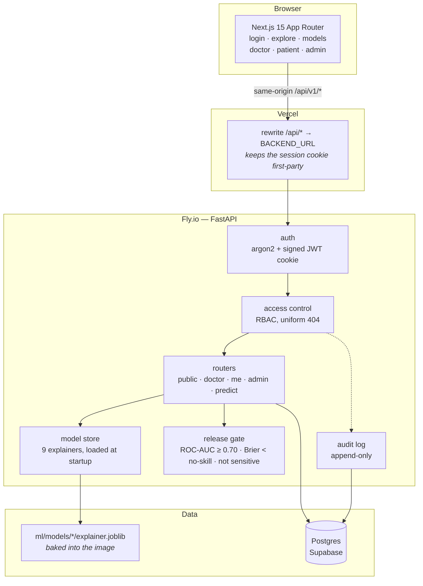
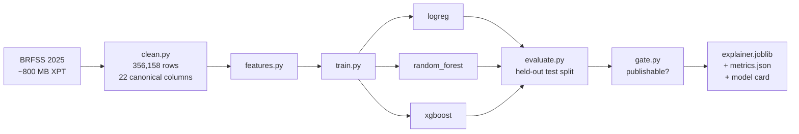

# HealthLens architecture

One sentence: a survey-trained risk model is served behind a role-aware API, and the
browser only ever talks to the Next.js app, which proxies everything else.

## The three tiers



## Offline: how a model gets made

Training never happens in the API. It is a separate pipeline whose only output is an
artifact the backend loads read-only.



The registry (`ml/src/conditions.yaml`) is the single source of truth for the nine
conditions. No disease name is hard-coded anywhere in the code — a test enforces that.
`registry.feature_columns()` is the leakage guard: a condition's own outcome column, and
every other condition's outcome, are excluded from its predictors.

## Decisions worth defending in the presentation

**Why the frontend proxies instead of calling the API directly.** The session is an
`httpOnly` cookie. With the frontend on Vercel and the API on Fly, a direct browser call
is cross-site, and browsers increasingly refuse those cookies. Rewriting `/api/*` through
Vercel makes every call same-origin, so the cookie is first-party and the same code works
locally and deployed with no conditional logic.

**Why authorization lives in the backend, not the UI.** Hiding a button is not access
control. Every record-scoped route re-derives what the caller may see, and a record the
caller is not entitled to returns the *same* 404 as a record that does not exist — so the
response cannot be used to discover which patient IDs are real.

**Why a release gate.** A model that scores poorly is more dangerous than no model,
because a number on screen reads as authoritative. The gate refuses to serve individual
estimates unless held-out ROC-AUC ≥ 0.70 and the Brier score beats predicting the base
rate, and it refuses outright for conditions flagged `sensitive` regardless of accuracy.
Live example: asthma trains fine but is withheld at ROC-AUC 0.66, and depression is
withheld as sensitive even though it trains comparably to the rest.

**Why logistic regression usually wins.** All three model families land within 0.01
ROC-AUC on every condition, which says BRFSS carries little exploitable non-linearity.
Selection takes the best validation score and treats anything within 0.005 as tied,
choosing the simplest — so logistic regression is selected for 6 of 9. Diabetes is one of
the exceptions and selects a random forest.

**Why the API is not on Vercel.** It loads the trained pipelines at startup and keeps
them resident. Serverless functions are per-request and capped well below that.

## Where the parts live

| Path | What it is |
| --- | --- |
| `ml/src/` | Training pipeline, registry, gate, explanations. Never imported by request handlers except `registry`, `features`, `explain`. |
| `ml/models/<condition>/` | Per-condition artifacts. The API reads only `explainer.joblib`. |
| `backend/app/routers/` | `public`, `doctor`, `me`, `admin`, `predict`, `auth`. |
| `backend/app/access.py` | RBAC and the uniform-404 rule; writes the audit log. |
| `backend/app/db/` | Every SQL statement, parameterised, in one place. |
| `frontend/app/` | App Router pages, one per role plus the shared explore/models views. |
| `frontend/next.config.ts` | The `/api/*` rewrite. |

## Running it

```bash
docker compose up --build
```

Postgres, API and frontend, seeded, on <http://localhost:3000>. Deployment is in
[DEPLOYMENT.md](DEPLOYMENT.md).
