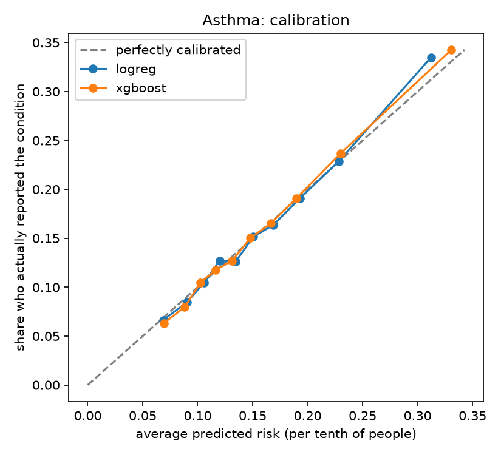

# Model card: Asthma

_Generated by `python -m ml.src.model_card` from the trained model files. Regenerate after retraining; edit the wording in this generator, not here._

**What is predicted:** Respondent reports having asthma, as defined in the survey codebook.

**Chosen model:** xgboost (highest validation ROC-AUC; models within 0.005 of the best count as tied and the simpler one (logreg before xgboost) is chosen).

## Intended use

- Explore which self-reported risk factors are associated with asthma among US adults, in a course project with synthetic patients.
- Give an indicative, population-based estimate for one person, with the factors that pushed it up or down, **only if** the release gate below allows it.

## Not intended for

- Diagnosing anyone, or deciding on tests or treatment.
- Screening real patients, or any decision about insurance, employment or access to care.
- People outside the training population (children; populations outside the US) without re-validation.

## Data

- Source: BRFSS 2025 (`brfss_clean.parquet`); self-reported survey answers.
- Rows with a known answer: 283,915 training, 70,979 held-out test (11,202 reporting the condition).
- Inputs (15): bmi, age_band, gen_health, income_band, education_band, risk_factor_count, lifestyle_score, phys_active, heavy_alcohol, fruit_daily, veg_daily, high_chol, sex, smoker, bmi_band.
- Missing answers stay missing and are handled inside the model; a missing outcome is never counted as "no".
- Seed 42; code version `20a5a48f2d`; trained 2026-11-12T04:02:09+00:00.

## Performance on held-out data

| Model | ROC-AUC | PR-AUC | Brier (no-skill) | Recall @ chosen cut-off | Precision | Cut-off |
|---|---|---|---|---|---|---|
| logreg | 0.653 | 0.269 | 0.127 (0.133) | 81% | 19% | 0.118 |
| xgboost (chosen) | 0.661 | 0.278 | 0.126 (0.133) | 81% | 20% | 0.117 |

The cut-off is chosen on validation data to catch at least 80% of people who report the condition (screening favours not missing people over avoiding false alarms).

## Results by group

Not computed for this condition (Tier 2: overall metrics only). Run with `--subgroups` to add them.

## Release gate (ADR-0016)

Individual estimates: **population analytics only**. Signal strength: **weak**.

> Population analytics only: the model's accuracy on held-out data (ROC-AUC 0.66) is below our minimum of 0.70, so a personal estimate could mislead.

## Limitations

- This is not a diagnosis. It's a statistical estimate from survey answers, and a health professional should be consulted about any concern.
- The model learned from self-reported answers (people's own account of their diagnoses, weight and habits), which can be inaccurate.
- The survey is a snapshot in time, so the model finds patterns linked with the condition, not causes. Changing one factor won't necessarily change the risk by the amount shown.
- It was trained on US adults (CDC BRFSS 2025). It may not describe people in Canada or other countries, and it says nothing about children.
- It only knows the factors the survey asks about. Family history, lab results, medication and many other things a clinician would consider aren't included.
- Training was unweighted; population percentages on the dashboard use the survey weights.
