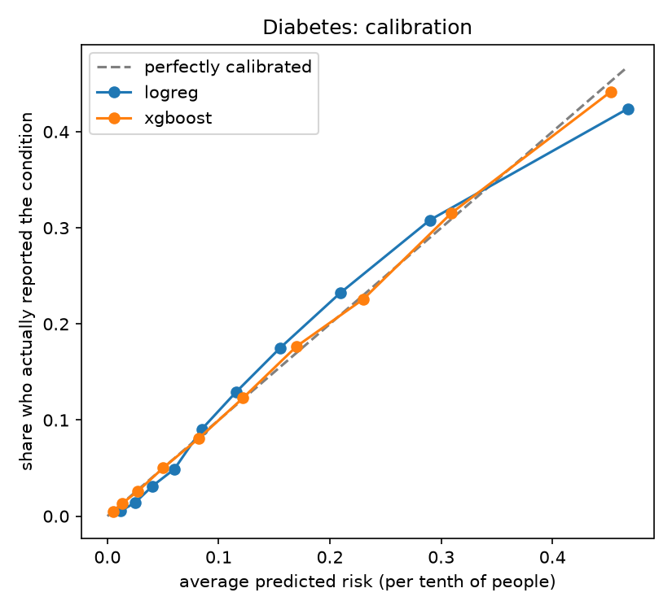

# Model card: Diabetes

_Generated by `python -m ml.src.model_card` from the trained model files. Regenerate after retraining; edit the wording in this generator, not here._

**What is predicted:** Respondent reports having been told by a health professional that they have diabetes.

**Chosen model:** xgboost (highest validation ROC-AUC; models within 0.005 of the best count as tied and the simpler one (logreg before xgboost) is chosen).

## Intended use

- Explore which self-reported risk factors are associated with diabetes among US adults, in a course project with synthetic patients.
- Give an indicative, population-based estimate for one person, with the factors that pushed it up or down, **only if** the release gate below allows it.

## Not intended for

- Diagnosing anyone, or deciding on tests or treatment.
- Screening real patients, or any decision about insurance, employment or access to care.
- People outside the training population (children; populations outside the US) without re-validation.

## Data

- Source: BRFSS 2025 (`brfss_clean.parquet`); self-reported survey answers.
- Rows with a known answer: 284,301 training, 71,075 held-out test (10,365 reporting the condition).
- Inputs (15): bmi, age_band, gen_health, income_band, education_band, risk_factor_count, lifestyle_score, phys_active, heavy_alcohol, fruit_daily, veg_daily, high_chol, sex, smoker, bmi_band.
- Missing answers stay missing and are handled inside the model; a missing outcome is never counted as "no".
- Seed 42; code version `20a5a48f2d`; trained 2026-11-12T04:00:41+00:00.

## Performance on held-out data

| Model | ROC-AUC | PR-AUC | Brier (no-skill) | Recall @ chosen cut-off | Precision | Cut-off |
|---|---|---|---|---|---|---|
| logreg | 0.794 | 0.368 | 0.107 (0.125) | 80% | 28% | 0.125 |
| xgboost (chosen) | 0.803 | 0.384 | 0.105 (0.125) | 81% | 29% | 0.138 |

The cut-off is chosen on validation data to catch at least 80% of people who report the condition (screening favours not missing people over avoiding false alarms).

## Results by group

Chosen model, at the chosen cut-off. Groups with fewer than 30 people are not scored.

| Group | People | Reporting it | Recall | PR-AUC | Avg. estimate vs actual |
|---|---|---|---|---|---|
| Sex: female | 37,315 | 14% | 79% | 0.376 | 14% vs 14% |
| Sex: male | 33,760 | 15% | 83% | 0.393 | 15% vs 15% |
| Age group: 18-34 | 12,006 | 2% | 9% | 0.101 | 2% vs 2% |
| Age group: 35-49 | 13,110 | 7% | 51% | 0.267 | 7% vs 7% |
| Age group: 50-64 | 16,468 | 17% | 82% | 0.405 | 18% vs 17% |
| Age group: 65+ | 28,167 | 22% | 88% | 0.398 | 22% vs 22% |
| Age group: not stated | 1,324 | 12% | 64% | 0.267 | 13% vs 12% |
| Household income: under $35k | 14,536 | 21% | 91% | 0.447 | 21% vs 21% |
| Household income: $35k-$100k | 25,032 | 15% | 82% | 0.369 | 15% vs 15% |
| Household income: $100k+ | 17,585 | 9% | 64% | 0.302 | 9% vs 9% |
| Household income: not stated | 13,922 | 15% | 78% | 0.364 | 14% vs 15% |

## Release gate (ADR-0016)

Individual estimates: **enabled**. Signal strength: **strong**.

> Individual estimates enabled: held-out ROC-AUC 0.80 (strong signal) and risk percentages better than guessing the average (Brier 0.105 vs 0.125).

## Limitations

- This is not a diagnosis. It's a statistical estimate from survey answers, and a health professional should be consulted about any concern.
- The model learned from self-reported answers (people's own account of their diagnoses, weight and habits), which can be inaccurate.
- The survey is a snapshot in time, so the model finds patterns linked with the condition, not causes. Changing one factor won't necessarily change the risk by the amount shown.
- It was trained on US adults (CDC BRFSS 2025). It may not describe people in Canada or other countries, and it says nothing about children.
- It only knows the factors the survey asks about. Family history, lab results, medication and many other things a clinician would consider aren't included.
- Training was unweighted; population percentages on the dashboard use the survey weights.
- It misses more cases for people in the group "age group 18-34" (catches 9% vs 81% overall).
- It misses more cases for people in the group "age group 35-49" (catches 51% vs 81% overall).
- It misses more cases for people in the group "household income $100k+" (catches 64% vs 81% overall).
