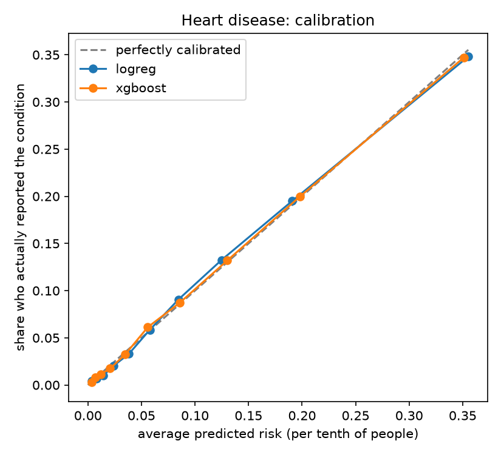

# Model card: Heart disease

_Generated by `python -m ml.src.model_card` from the trained model files. Regenerate after retraining; edit the wording in this generator, not here._

**What is predicted:** Respondent reports a history of heart attack or coronary heart disease.

**Chosen model:** logreg (highest validation ROC-AUC; models within 0.005 of the best count as tied and the simpler one (logreg before xgboost) is chosen).

## Intended use

- Explore which self-reported risk factors are associated with heart disease among US adults, in a course project with synthetic patients.
- Give an indicative, population-based estimate for one person, with the factors that pushed it up or down, **only if** the release gate below allows it.

## Not intended for

- Diagnosing anyone, or deciding on tests or treatment.
- Screening real patients, or any decision about insurance, employment or access to care.
- People outside the training population (children; populations outside the US) without re-validation.

## Data

- Source: BRFSS 2025 (`brfss_clean.parquet`); self-reported survey answers.
- Rows with a known answer: 281,716 training, 70,429 held-out test (6,337 reporting the condition).
- Inputs (15): bmi, age_band, gen_health, income_band, education_band, risk_factor_count, lifestyle_score, phys_active, heavy_alcohol, fruit_daily, veg_daily, high_chol, sex, smoker, bmi_band.
- Missing answers stay missing and are handled inside the model; a missing outcome is never counted as "no".
- Seed 42; code version `20a5a48f2d`; trained 2026-11-12T04:01:38+00:00.

## Performance on held-out data

| Model | ROC-AUC | PR-AUC | Brier (no-skill) | Recall @ chosen cut-off | Precision | Cut-off |
|---|---|---|---|---|---|---|
| logreg (chosen) | 0.826 | 0.317 | 0.070 (0.082) | 80% | 21% | 0.087 |
| xgboost | 0.828 | 0.320 | 0.070 (0.082) | 80% | 21% | 0.089 |

The cut-off is chosen on validation data to catch at least 80% of people who report the condition (screening favours not missing people over avoiding false alarms).

## Results by group

Chosen model, at the chosen cut-off. Groups with fewer than 30 people are not scored.

| Group | People | Reporting it | Recall | PR-AUC | Avg. estimate vs actual |
|---|---|---|---|---|---|
| Sex: female | 37,000 | 7% | 72% | 0.254 | 7% vs 7% |
| Sex: male | 33,429 | 11% | 85% | 0.355 | 11% vs 11% |
| Age group: 18-34 | 11,972 | 1% | 1% | 0.035 | 1% vs 1% |
| Age group: 35-49 | 13,041 | 2% | 29% | 0.123 | 3% vs 2% |
| Age group: 50-64 | 16,335 | 8% | 66% | 0.229 | 8% vs 8% |
| Age group: 65+ | 27,778 | 16% | 90% | 0.353 | 16% vs 16% |
| Age group: not stated | 1,303 | 7% | 57% | 0.176 | 7% vs 7% |
| Household income: under $35k | 14,323 | 13% | 87% | 0.341 | 14% vs 13% |
| Household income: $35k-$100k | 24,827 | 9% | 80% | 0.320 | 9% vs 9% |
| Household income: $100k+ | 17,540 | 5% | 66% | 0.260 | 5% vs 5% |
| Household income: not stated | 13,739 | 9% | 79% | 0.322 | 9% vs 9% |

## Release gate (ADR-0016)

Individual estimates: **enabled**. Signal strength: **strong**.

> Individual estimates enabled: held-out ROC-AUC 0.83 (strong signal) and risk percentages better than guessing the average (Brier 0.070 vs 0.082).

## Limitations

- This is not a diagnosis. It's a statistical estimate from survey answers, and a health professional should be consulted about any concern.
- The model learned from self-reported answers (people's own account of their diagnoses, weight and habits), which can be inaccurate.
- The survey is a snapshot in time, so the model finds patterns linked with the condition, not causes. Changing one factor won't necessarily change the risk by the amount shown.
- It was trained on US adults (CDC BRFSS 2025). It may not describe people in Canada or other countries, and it says nothing about children.
- It only knows the factors the survey asks about. Family history, lab results, medication and many other things a clinician would consider aren't included.
- Training was unweighted; population percentages on the dashboard use the survey weights.
- It misses more cases for people in the group "age group 18-34" (catches 1% vs 80% overall).
- It misses more cases for people in the group "age group 35-49" (catches 29% vs 80% overall).
- It misses more cases for people in the group "age group 50-64" (catches 66% vs 80% overall).
- It misses more cases for people in the group "household income $100k+" (catches 66% vs 80% overall).
