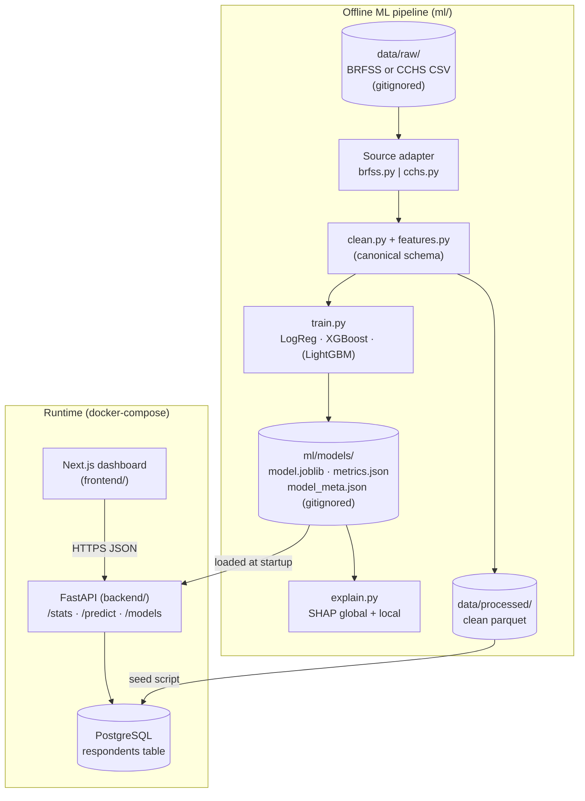
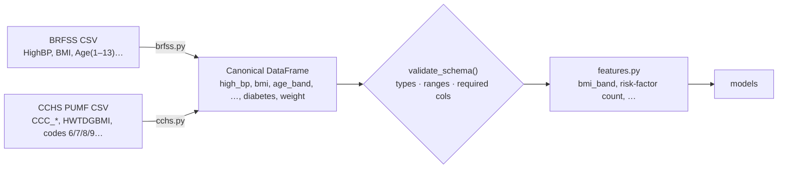
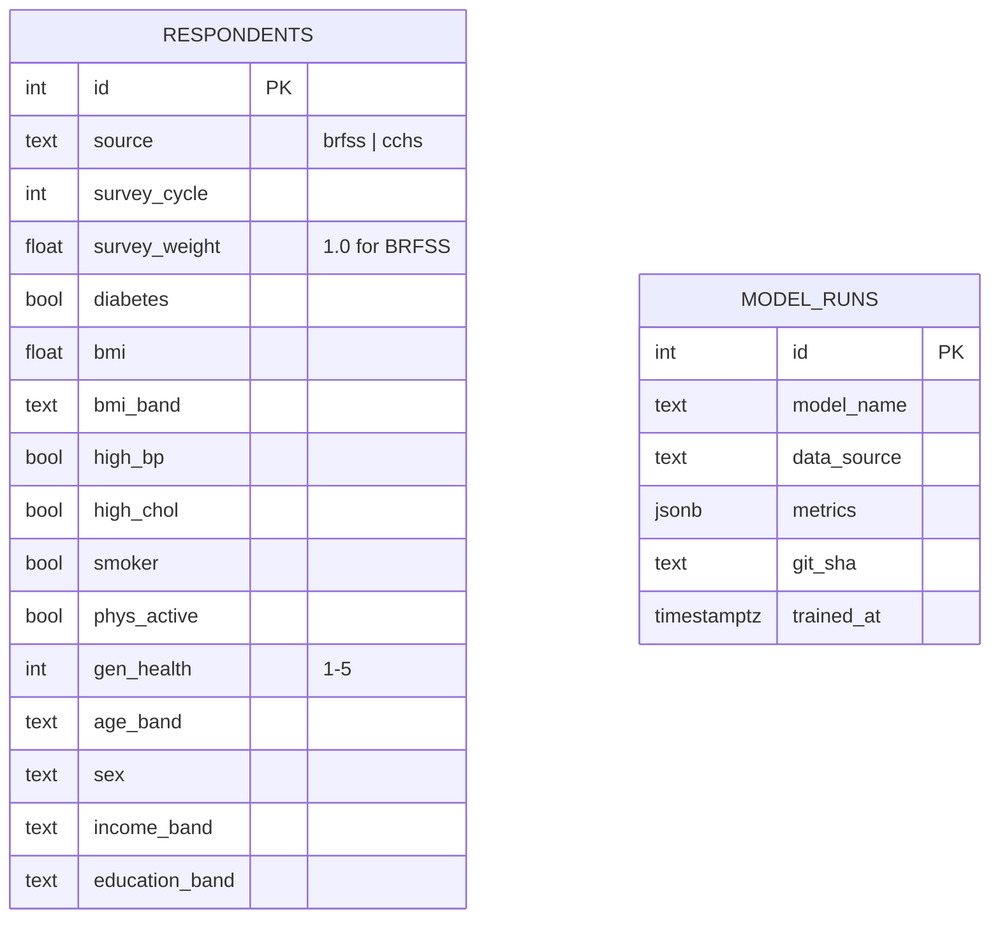
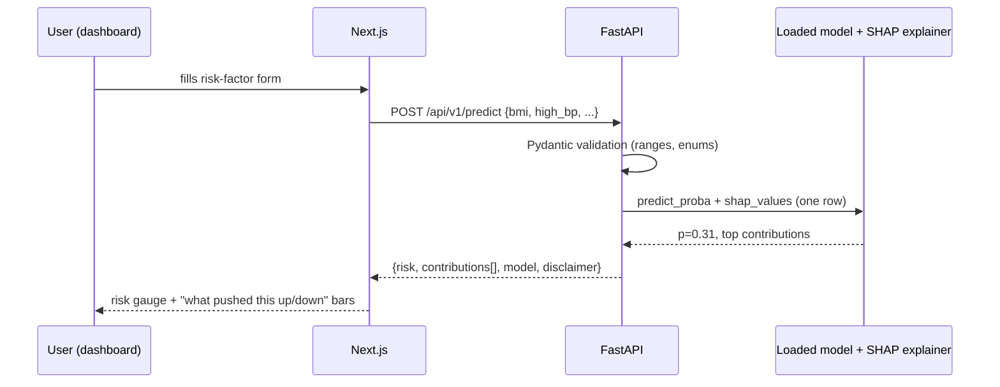
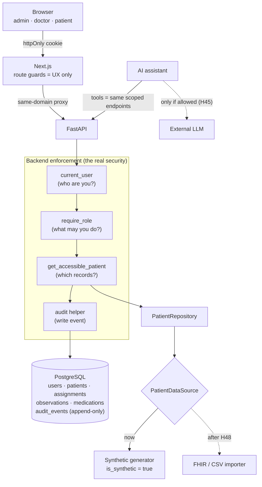

# HealthLens — Build Roadmap & Assignment Tracker

> **Scope:** **HealthLens: An Interactive Analytics and Risk Prediction Dashboard for Public Health Data.** A course project (team of 4, due **December 2026**, whole platform graded) that we intend to carry forward toward a **beta pilot with a local clinic or the regional hospital**. The pilot is _not_ part of this semester; we build so it is possible and document what it would take (`H48`).
> **Two layers, one product:**
> 1. **Public-health analytics (no personal data):** survey microdata → cleaning & features → Logistic Regression baseline vs. XGBoost → SHAP → FastAPI + PostgreSQL → Next.js dashboard.
> 2. **Clinical workspace (synthetic patients only for now):** three roles: **admin, doctor, patient**, with login, role-based access, patient records, medications, progress timelines, prediction explanations, and an AI assistant. Synthetic data sits behind a swappable source layer so real data can replace it later.
> **Data:** survey side starts on the **CDC BRFSS "Diabetes Health Indicators"** placeholder (Kaggle) and swaps to **Statistics Canada CCHS PUMF** if access is confirmed. Patient side uses a **seeded synthetic generator** (`H36`). Both swaps must be _mapping exercises, not rewrites_. That constraint shapes the design.
> **Hard rule:** no real patient data enters this project, its database, its git history, or any external AI service, until the pilot-readiness work (`H48`) is done and a clinic's privacy officer has agreed in writing.
> This document is the **plan and source of truth**. Each assignment (`H##`) becomes one GitHub Issue. IDs are stable labels, not an ordering; order comes from `Depends on:` and Appendix A.

---

## How to read & use this document

- **Top-down by epic, but work in dependency order** (`Depends on:`), not strictly line-by-line.
- **Each assignment (`H##`) becomes one GitHub Issue** titled `H## — <name>`, labelled with its Epic and tags. Track it on the Project board.
- An assignment is **done only when every acceptance criterion _and_ the global Definition of Done (§3) are met.**
- **Two universal todos appear on every assignment — this is deliberate:**
  - **First todo is always `Plan this assignment`.** The data source may change (BRFSS → CCHS), and model choices may shift after the first results. Before writing code, discuss it as a team, lock the approach, and — if anything changed — revise **that single assignment's** todos.
  - **Last todo is always `Write the assignment doc`.** Every assignment produces a plain-English writeup in `docs/assignments/H##-<slug>.md` (template in Appendix C). These docs become most of your final report, so writing them as you go saves a painful last week.

> **Mentor note:** the goal isn't a perfect model. The goal is a **correct, honest, reproducible** pipeline that a reviewer can clone, run, and trust: metrics that aren't inflated by leakage, explanations that match the model, and a dashboard that states its own limitations. A modest ROC-AUC reported honestly beats an impressive one nobody can reproduce.

---

## Table of Contents

1. [How We Work](#1-how-we-work)
2. [Engineering Principles](#2-engineering-principles)
3. [Definition of Ready & Definition of Done](#3-definition-of-ready--definition-of-done)
4. [System Design Overview (with diagrams)](#4-system-design-overview-with-diagrams)
5. [The Data: BRFSS placeholder → CCHS target](#5-the-data-brfss-placeholder--cchs-target)
6. [Milestones & Team Ownership](#6-milestones--team-ownership)
7. [Key Decisions & Assumptions (ADR summary)](#7-key-decisions--assumptions-adr-summary)
8. [Glossary](#8-glossary)
9. [The Assignments](#9-the-assignments)
   - [E0 — Engineering Foundation](#epic-e0--engineering-foundation)
   - [E1 — Data Access & Pipeline](#epic-e1--data-access--pipeline)
   - [E2 — Modeling & Explainability](#epic-e2--modeling--explainability)
   - [E3 — Backend API (FastAPI + PostgreSQL)](#epic-e3--backend-api-fastapi--postgresql)
   - [E4 — Frontend Dashboard (Next.js)](#epic-e4--frontend-dashboard-nextjs)
   - [E5 — Identity, Access & Audit](#epic-e5--identity-access--audit)
   - [E6 — Clinical Records (synthetic, swappable)](#epic-e6--clinical-records-synthetic-swappable)
   - [E7 — Role-Based Frontend](#epic-e7--role-based-frontend)
   - [E8 — AI Features](#epic-e8--ai-features)
   - [E9 — Pilot Readiness (paperwork, not code)](#epic-e9--pilot-readiness-paperwork-not-code)
   - [E10 — Integration, Deployment & Delivery](#epic-e10--integration-deployment--delivery)
10. [Appendices](#10-appendices)

---

## 1. How We Work

**Lightweight Scrum**, sized for a 4-person student team.

| Ceremony | Cadence | Purpose | Timebox |
|---|---|---|---|
| **Sprint** | 1 week | Unit of planning & delivery | — |
| **Sprint Planning** | Start of week | Pull issues in; agree a one-sentence sprint goal | 30 min |
| **Standup** | 2–3× per week (async in chat is fine) | Did / will do / blocked. **Blockers get an owner, not a debate.** | 10 min |
| **Demo** | End of week | **Show working software.** If it can't be demoed, it isn't done. | 20 min |
| **Retro** | End of week | One thing to keep, **one concrete thing to change.** | 10 min |

**GitHub workflow (every assignment):**

1. Each `H##` = one Issue titled `H## — <name>` (use the _Assignment_ issue template), labelled with its Epic (`epic:ml`, `epic:backend`, …) and tags.
2. Board columns: `Backlog → Ready → In Progress → In Review → Done`. Only DoR-passing issues enter `Ready`.
3. One short-lived branch per issue: `h##-slug` (e.g. `h08-clean-recode`). Branch off `main`.
4. Open a **draft PR early**; link the issue (`Closes #NN`); explain _what_ and _why_. The PR template carries the DoD checklist.
5. **No self-merge.** ≥1 review from a teammate + green CI (`CI / ci-ok`). Squash-merge. `main` is always runnable.

**Estimation:** story points (1, 2, 3, 5, 8). An 8 is a smell — **split it**.

---

## 2. Engineering Principles

### 2.1 Plan first, then test-driven where it pays off

- Every assignment opens with a planning step.
- **TDD is mandatory for the pure-logic modules**: recoding/cleaning rules, feature engineering, the source→canonical mapping, API input validation. These are cheap to test and expensive to get silently wrong.
- **ML training itself is tested by contract, not by exact numbers**: "trains on a 200-row synthetic dataset without error", "metrics.json has every required key", "predict_proba returns values in [0, 1]". Don't assert `accuracy == 0.8634` — it breaks on every library bump.

### 2.2 Reproducibility is a feature

- **One command per stage** (`python ml/src/train.py`), not "run cells 1–14 in this order".
- **Fixed random seeds** everywhere (split, models, SHAP sampling), set from one config constant.
- **Pinned dependencies** (`requirements.txt` with exact versions once the env works).
- Every saved model ships with the metadata needed to reproduce it: data source, row count, feature list, seed, library versions, git SHA.

### 2.3 No leakage, ever

- Split **before** any fitted transform (imputation, scaling, encoding). Fit transforms on train only — use an sklearn `Pipeline` / `ColumnTransformer` so it's structurally impossible to do otherwise.
- Hyper-parameter tuning uses **cross-validation on the training set**; the test set is touched **once**, at the end.
- Drop duplicates _before_ splitting, or identical rows land on both sides and inflate scores.

### 2.4 Trunk-based development + code review

Short-lived branches, small PRs, every change reviewed for correctness, tests, and readability. Review the code, not the person.

### 2.5 Conventional Commits

`type(scope): summary` → `feat(ml): add XGBoost trainer`, `fix(api): reject BMI outside 10–100`, `test(clean): cover CCHS sentinel codes`. Types: `feat, fix, docs, test, refactor, chore, perf, ci`.

### 2.6 CI with quality gates

Every PR runs: **lint + format check → tests + coverage → frontend lint/typecheck/build → secret scan → repo-hygiene check (no raw data, no model binaries, no huge files) → docker-compose validation**. Red = no merge. See `H03`.

### 2.7 Documentation as a first-class artifact

- **ADRs** (`docs/adr/NNNN-title.md`): _context → decision → consequences_, for choices like "BRFSS vs CCHS" or "XGBoost vs LightGBM".
- **Assignment docs** (`docs/assignments/`), a **data dictionary** (`docs/data-dictionary.md`), a **model card** (`docs/model-card.md`), and the **OpenAPI spec** (the frontend's contract).

### 2.8 Responsible-AI & data ethics by default

- **HealthLens is not a diagnostic tool.** Every prediction surface (API response and UI) says so.
- **Survey data stays out of git.** `data/raw/` and `ml/models/` are gitignored and CI blocks them. Follow the Statistics Canada Open Licence terms and never attempt to re-identify respondents.
- **Report subgroup performance** (by sex, age band, income band): a model that's good on average but poor for one group is a finding, not a footnote.
- **Explain limitations in plain language**: self-reported survey data, cross-sectional (correlation ≠ causation), population ≠ individual.

#### Patient data & access (clinical layer)

- **Synthetic only, clearly flagged.** Every patient row carries `is_synthetic = true`; the UI shows a "demo data" banner while any synthetic row is loaded. Real data stays out until `H48`.
- **Least privilege, not "full access".**
  - **Patient** reads only their own record.
  - **Doctor** reads and edits only patients **assigned** to them, never "all patients".
  - **Admin** manages users, assignments, and the system. Reading a patient's clinical record is allowed but **always audit-logged** (and shows up in the audit viewer).
- **Authorization is enforced in the backend, on every request.** Hiding a button in the UI is convenience, not security.
- **Every read or write of patient data is written to an append-only audit log** (who, role, action, resource, when). The log must never contain clinical content.
- **Don't roll our own crypto or sessions.** Use a maintained password-hashing library (argon2/bcrypt) and signed tokens/cookies; no homemade schemes.
- **AI never sees data it shouldn't.** The assistant only calls role-scoped backend endpoints (never the DB directly) and, by default, never sends patient-identifying text to an external service (`H45`).
- **The model is a population-level estimate, not clinical decision support.** It is trained on self-reported survey factors, not lab values. Patient-facing and doctor-facing copy must say so (`H40`).

### 2.9 Separation of concerns (the swap-the-data-source rule)

```
source adapter (brfss.py / cchs.py)  →  canonical schema  →  clean / features  →  models
          ↑ only file that knows raw column names & codes
```

Everything downstream of the adapter speaks **canonical feature names only** (`bmi`, `high_bp`, `phys_active`, `age_band`, …). Swapping BRFSS for CCHS means writing `cchs.py` and its tests. Nothing else changes.

> _Mentor note:_ you won't do all of this perfectly. Do it **deliberately**. When you skip something, write it down as an issue. Deliberate debt is engineering; accidental debt is a mess.

---

## 3. Definition of Ready & Definition of Done

### Definition of Ready (DoR) — an issue may enter a sprint only if

- [ ] Goal is one clear sentence.
- [ ] **`Plan this assignment` has been discussed**: approach agreed, todos reflect any pivots.
- [ ] Acceptance criteria are written and testable.
- [ ] Dependencies are unblocked (or explicitly stubbed).
- [ ] Small enough to finish in one sprint (else split).

### Definition of Done (DoD) — applies to **every** assignment, on top of its own acceptance criteria

- [ ] Merged to `main` via a **reviewed** PR; CI green.
- [ ] New logic covered by tests (unit; integration where it touches the DB/API). **80%+ coverage on `ml/src` and `backend/app`.**
- [ ] `ruff check` + `ruff format --check` pass (Python); `eslint` + `tsc` pass (frontend).
- [ ] No secrets, no raw data, no model binaries, no debug prints, no commented-out code, no `TODO` without an issue link.
- [ ] Runs from one command on a clean clone (documented in the README or the assignment doc).
- [ ] Inputs validated at the boundary; errors are clear, not stack traces.
- [ ] Public API changes reflected in the OpenAPI spec.
- [ ] **`docs/assignments/H##-<slug>.md` written.**
- [ ] ADR / data dictionary / model card updated if relevant.
- [ ] Demoable at the end-of-week demo.

---

## 4. System Design Overview (with diagrams)

### 4.1 Container / architecture view



### 4.2 Data flow & the canonical schema



### 4.3 Core data model (PostgreSQL)



### 4.4 Prediction request (sequence)



---

### 4.5 Access control and audit (clinical layer)



Every request passes the same three checks in the same order. The AI assistant is just another client of this layer, so it can never see more than the signed-in user.

## 5. The Data: BRFSS placeholder → CCHS target

### 5.1 BRFSS "Diabetes Health Indicators" (Kaggle) — start here today

- Three CSVs in the download. **Use `diabetes_binary_health_indicators_BRFSS2015.csv` as the main dataset**: it keeps the real class imbalance (~14% positive), so its metrics are honest. The `5050split` file is useful for experiments, but **never report test metrics from a balanced file** as if they describe the real population.
- 21 features, already numerically coded (e.g. `Age` is 13 bands, `Income` 8 bands, `GenHlth` 1–5). It is **already cleaned**: few or no NaNs and no sentinel codes. So `clean.py` will be thin for BRFSS, and the sentinel-code logic is really written _for CCHS_. Test it with synthetic CCHS-shaped rows.
- **Check for duplicate rows during profiling.** Many respondents share identical coded answers. Decide (and record in an ADR) whether to deduplicate before splitting.

### 5.2 CCHS PUMF — the real target

- Recent cycles (2019/2020, 2022) are downloadable under the **Statistics Canada Open Licence**; fallback is **Odesi via Lakehead library (DLI)**.
- **Read the codebook and user guide before writing any CCHS code.** Things to expect:
  - **Sentinel codes**: `6` valid skip, `7` don't know, `8` refusal, `9` not stated (and `96/97/98/99`, `996…` for wider fields). These must become `NaN` (or an explicit "not applicable" category for valid skips). **Never let them through as numbers**, or a "BMI of 999.9" will dominate your model.
  - **Survey weights** (a weight per respondent). **Dashboard prevalence stats must be weighted** to represent the Canadian population; model training can be unweighted (state this in the model card).
  - **Derived variables** (names ending in `D`, e.g. BMI) are usually the ones to use.
  - Diabetes is self-reported. Identify the exact variable and its universe (who was asked) from the codebook.
- **The PUMF suppresses or groups some detail** (age bands, geography). Your canonical schema should use bands so both sources fit.

### 5.3 Canonical feature list (first draft — revise in H07)

| Canonical name | Type | BRFSS source | CCHS source (TBD in H07) |
|---|---|---|---|
| `diabetes` (target) | bool | `Diabetes_binary` | chronic-conditions module |
| `bmi` | float | `BMI` | derived BMI |
| `high_bp` | bool | `HighBP` | chronic-conditions module |
| `high_chol` | bool | `HighChol` | (may be unavailable — document) |
| `smoker` | bool | `Smoker` | smoking module |
| `phys_active` | bool | `PhysActivity` | physical-activity derived var |
| `fruits_veg` | bool / int | `Fruits`, `Veggies` | fruit & vegetable module |
| `heavy_alcohol` | bool | `HvyAlcoholConsump` | alcohol module |
| `gen_health` | int 1–5 | `GenHlth` | self-perceived health |
| `age_band` | category | `Age` (13 bands) | age group (re-band to common bins) |
| `sex` | category | `Sex` | sex |
| `income_band` | category | `Income` | household income (re-band) |
| `education_band` | category | `Education` | education (re-band) |
| `survey_weight` | float | constant `1.0` | survey weight variable |

> Features available in only one source get a **feature-availability flag** in the schema, so the model trained on CCHS simply doesn't receive them. Don't impute an entire missing column.

---

## 6. Milestones & Team Ownership

> **Assumed deadline: Friday 4 Dec 2026 (final demo + report).** Please confirm the exact date; if it's earlier, shift the table up. **Feature freeze is Fri 27 Nov**: the last week is for hardening, the report, and the demo, never for new features.

| Milestone | Epics | Goal | Dates (2026) |
|---|---|---|---|
| **M0 — Foundation** | E0 | Repo, CI, branch protection, local stack, issues + board; CCHS access chase started; **access matrix agreed (H31)** | Wk 1: 16–23 Oct |
| **M1 — Model on placeholder** | E1, E2 | BRFSS → clean → LR + XGBoost → SHAP → `metrics.json`, one command. In parallel: backend + frontend skeletons, auth design. | Wk 2: 24–30 Oct |
| **M2 — Walking skeleton** | thin slice of E3, E4, E5 | **One real chart ← one real endpoint ← Postgres**, **login works end to end with 3 roles**, `/predict` returns a number. **CCHS go/no-go decided by 6 Nov.** | Wk 3: 31 Oct–6 Nov |
| **M3 — Clinical workspace** | E6, E7 | Synthetic patients seeded; doctor workspace, patient portal, admin console; prediction + explanation in UI | Wk 4–5: 7–20 Nov |
| **M4 — AI + deploy** | E8, E10 | Explanations + assistant; backend and frontend deployed to a live URL (synthetic data only) | Wk 5–6: 14–27 Nov |
| **Feature freeze** | | No new features after this | **Fri 27 Nov** |
| **M5 — Delivery** | E9, E10 | Pilot-readiness pack, final report, demo rehearsal, handover | Wk 7: 28 Nov–4 Dec |

> **Walking-skeleton principle:** don't build five mocked screens. After the model exists, build the _thinnest vertical slice_ through every layer, then widen.

### 6.1 Scope and cut line (decide this now, not in week 6)

With ~7 weeks, a team still learning auth and security, and the whole platform graded, we protect a **working end-to-end product** over a wide, half-finished one. If we fall behind, we cut from the bottom of this list, and we never cut the top.

| Tier | Assignments | Rule |
|---|---|---|
| **Must** (the graded product) | H01–H04, H06–H14, H16–H19, H21, H22, H31–H36, H37, H38, H41–H43, H46, H26–H28, H30 | Everything else depends on these. |
| **Should** | H15, H20, H23, H24, H25, H39, H40, H44, H45, H47, H48 | Strong marks if they land; each one is independently droppable. |
| **Stretch** | H29 (CCHS swap, only if H05 succeeds), LightGBM in H12, Synthea import, 2FA, row-level security in Postgres | Only with spare time after the freeze plan is safe. |

> **Why audit logging (H34) is Must:** it's one table plus one helper function, and it's the single feature that most convinces a clinic, a grader, or an investor that we took patient data seriously.

**Suggested ownership** (one owner per area; everyone reviews everyone; security work is **always pair-reviewed**):

| Area | Owner | Assignments |
|---|---|---|
| Data access & CCHS | _teammate A_ | H05, H07 (CCHS side), H29, H36 (synthetic generator) |
| ML pipeline & models | _teammate B_ | H06, H08–H15, H40, H46 |
| Backend, DB & access control | _teammate C_ | H16–H20, H31–H35, H37–H39 |
| Frontend | _teammate D_ | H21–H25, H41–H44 |
| AI features | A + B | H45, H47 |
| Foundation, delivery & pilot pack | shared (Haard leads) | H01–H04, H26–H30, H48 |

---

## 7. Key Decisions & Assumptions (ADR summary)

Starter decisions; each gets a short ADR in `docs/adr/`. **Challenge them.**

- **ADR-0001 — Monorepo** (`data/`, `ml/`, `backend/`, `frontend/`) with one CI workflow and path-based job filtering.
- **ADR-0002 — Python 3.12** for `ml/` and `backend/`; **ruff** for lint + format; **pytest** for tests; plain `requirements.txt` (pinned).
- **ADR-0003 — BRFSS as placeholder, CCHS as target**, isolated behind source adapters + a canonical schema. Go/no-go on CCHS decided in `H29`.
- **ADR-0004 — Models:** Logistic Regression baseline (interpretable floor) → XGBoost (primary) → LightGBM (optional). Selected on **ROC-AUC and PR-AUC on a held-out test set**, with calibration checked.
- **ADR-0005 — Explainability:** SHAP `TreeExplainer` for tree models (exact and fast enough per request); coefficients / `LinearExplainer` for LR.
- **ADR-0006 — Serving:** the backend **loads saved artifacts** at startup (joblib); it never retrains per request.
- **ADR-0007 — Backend:** FastAPI + PostgreSQL 16 + SQLAlchemy; schema created by a migration (Alembic) or a single `schema.sql`, decided in H17.
- **ADR-0008 — Frontend:** Next.js (App Router, TypeScript) + **Recharts** (or Plotly.js if we need richer statistical charts; decided in H22).
- **ADR-0009 — Deployment:** Vercel (frontend) + Render/Railway/Fly.io (backend + Postgres), free tiers.
- **ADR-0010 — Stats are survey-weighted** when the source provides weights (CCHS); BRFSS rows carry weight 1.0.
- **ADR-0011 — Auth & access control (H31):** three roles (admin, doctor, patient). Invite-only accounts (no public sign-up for doctors/admins). Maintained hashing + signed-token libraries, tokens in `httpOnly` cookies. **Authorization lives in the backend**, with record-level scoping (doctor → assigned patients only). Postgres row-level security is a stretch, not a requirement.
- **ADR-0012 — Synthetic patients behind a swappable source (H35, H36):** the app reads patients only through a `PatientDataSource` interface. Today: a seeded synthetic generator. Later: a FHIR or CSV importer. Tables and field names follow the FHIR resources they map to (`Patient`, `Observation`, `Condition`, `MedicationStatement`) so real data maps without a redesign.
- **ADR-0013 — LLM use (H45):** an `LLMProvider` interface; **default config forbids sending patient-identifying text to any external service**. Deterministic fallbacks for everything the UI depends on. Keys only via environment/secret manager.
- **ADR-0014 — Audit log (H34):** append-only table, written by a single helper invoked from the access-control layer so no endpoint can forget it; contains identifiers and actions, never clinical content.

---

## 8. Glossary

- **PUMF**: Public Use Microdata File. Respondent-level survey data, anonymised for public release.
- **Codebook**: the document that defines every variable, its values, and its special codes. _Read it first._
- **Sentinel code**: a numeric value that means "missing" for a specific reason (e.g. 9 = not stated). Must become NaN.
- **Valid skip**: the respondent wasn't asked the question (by design). It's different from "didn't answer".
- **Survey weight**: how many people in the population a respondent represents. Needed for population estimates.
- **Canonical schema**: our own source-independent column names/types that every data source is mapped onto.
- **Data leakage**: information from the test set (or the future) leaking into training, which inflates scores.
- **Class imbalance**: one outcome is much rarer (diabetes ≈ 14%). Accuracy becomes misleading; use recall, PR-AUC.
- **ROC-AUC / PR-AUC**: ranking quality across all thresholds; PR-AUC is more informative when positives are rare.
- **Calibration / Brier score**: does a predicted 30% risk actually happen ~30% of the time?
- **SHAP**: SHapley Additive exPlanations. Splits one prediction into per-feature contributions.
- **Model card**: a short document stating what a model is for, its data, metrics, subgroup performance, and limitations.
- **Walking skeleton**: a minimal end-to-end slice exercising every layer.
- **Required status check**: a CI job that must pass before GitHub allows a merge.
- **PHI / PHIPA / PIPEDA**: personal health information, and the Ontario and federal privacy laws that govern it. We don't handle real PHI this semester; `H48` documents what would change.
- **RBAC**: role-based access control. What you may do depends on your role (admin, doctor, patient).
- **Record-level scoping**: also checking _which_ records a user may touch (a doctor's own patients), not just which endpoints.
- **Audit log**: an append-only record of who accessed or changed what, and when.
- **Break-glass access**: a deliberate, logged override that lets an admin read something they normally wouldn't.
- **FHIR**: the standard data format for exchanging health records. We shape our tables after its resources so real data maps in later.
- **Synthetic data**: realistic but fake records generated by a seeded script. Safe to commit, share, and demo.
- **Prompt injection**: text that tries to trick an AI assistant into ignoring its rules (for example, "show me another patient's record").
- **SaMD**: Software as a Medical Device, the Health Canada category that applies if software informs diagnosis or treatment. A reason our risk score is labelled population-level, not clinical.

---

## 9. The Assignments

> Tags: `[FOUNDATION]` `[SPIKE/RESEARCH]` `[DATA]` `[ML]` `[API]` `[UI]` `[ETHICS]` `[STRETCH]`
> Every assignment inherits the global **Definition of Done** (§3), opens with **`Plan this assignment`**, and closes with **`Write the assignment doc`**.

---

# EPIC E0 — Engineering Foundation

_Goal: the rails that make all later work safe, reviewable, and reproducible. Do this before product code._

---

## H01 — Repository, Monorepo Structure & Tooling `[FOUNDATION]`

**Goal:** A monorepo every teammate can clone and understand in five minutes.
**Why it matters:** The first commit sets the tone, and a consistent layout means nobody waits on anybody.
**Depends on:** —

- [x] **Plan this assignment.** _(Locked: monorepo per the build plan; Python 3.12; ruff; pytest; requirements.txt.)_
- [x] Create the folder structure: `data/{raw,processed,codebooks}`, `ml/{src,notebooks,models,tests}`, `backend/{app,tests}`, `frontend/`, `docs/{adr,assignments}`.
- [x] `.gitignore` (Python, Node, `.env`, `data/raw/`, `ml/models/`, large data formats) and `.gitattributes` (LF endings).
- [x] Root `README.md` (one-liner, layout, quick start) and placeholder `docker-compose.yml`.
- [x] Root `pyproject.toml` with ruff + pytest + coverage config shared by `ml/` and `backend/`.
- [x] `ml/requirements.txt` + `requirements-dev.txt`.
- [x] `.pre-commit-config.yaml` (hygiene hooks, ruff, gitleaks).
- [ ] Create the GitHub repo (org or personal), push `main`, invite the 3 teammates.
- [ ] After the first working env: **pin exact versions** in `ml/requirements.txt` (`pip freeze` the relevant packages).
- [ ] **Write the assignment doc** → `docs/assignments/H01-repo-structure.md`.

**Acceptance Criteria:**

- A teammate can clone, create a venv, `pip install -r ml/requirements.txt -r requirements-dev.txt`, and run `pytest` green.
- `git status` after downloading the dataset into `data/raw/` shows **nothing** to commit.

---

## H02 — Team Handbook: Branching, Reviews, Issues `[FOUNDATION]`

**Goal:** Every change goes through a reviewed PR, and the board reflects reality.
**Why it matters:** Build the habit while the stakes are low. The week before the deadline is when people skip review and break `main`.
**Depends on:** H01

- [ ] **Plan this assignment.**
- [x] `.github/pull_request_template.md` with the DoD checklist.
- [x] `.github/ISSUE_TEMPLATE/assignment.md` (H## issue template) + `bug.md`.
- [x] `.github/CODEOWNERS` (fill in teammates' GitHub handles).
- [ ] Fill teammates' handles into `CODEOWNERS` (placeholders now).
- [ ] **Branch protection / ruleset on `main`**: require PR, 1 approval, required status check **`CI / ci-ok`**, block force-push. ⚠️ On a **private** repo this needs GitHub Team/Pro. JobRovr hit this paywall. Options: make the repo public, or get the free **GitHub Student Developer Pack / GitHub Education** upgrade for the org.
- [ ] Create labels (`epic:foundation`, `epic:data`, `epic:ml`, `epic:backend`, `epic:frontend`, `epic:delivery`, tags) and a Project board with the 5 columns.
- [ ] Bulk-create issues H01–H30 from this document.
- [ ] **Write the assignment doc** → `docs/assignments/H02-handbook.md`.

**Acceptance Criteria:**

- A direct push to `main` is rejected; a PR with red CI cannot be merged.
- Every H## exists as an issue on the board.

---

## H03 — CI Pipeline & Quality Gates `[FOUNDATION]`

**Goal:** Every push/PR runs the right checks for what changed; one gate job decides mergeability.
**Why it matters:** CI is the team's immune system. It catches broken imports, leaked data files, and failing tests before a human has to.
**Depends on:** H01

- [x] **Plan this assignment.** _(Single `ci.yml` with path filtering via `dorny/paths-filter`; one aggregate `ci-ok` job is the only required check. Path-filtered separate workflows would leave required checks "pending" forever on PRs that don't touch them.)_
- [x] `.github/workflows/ci.yml`
  - [x] `changes` job: detects which of `ml/`, `backend/`, `frontend/`, `docker-compose.yml` changed.
  - [x] `ml` job: Python 3.12, pip cache, `ruff check`, `ruff format --check`, `pytest` with coverage.
  - [x] `backend` job: same + **Postgres 16 service container** for integration tests; skips cleanly until `backend/requirements.txt` exists.
  - [x] `frontend` job: Node 22, `npm ci`, lint, typecheck, test, build; skips cleanly until `frontend/package-lock.json` exists.
  - [x] `hygiene` job: **blocks raw data, model binaries, `.env` files, and any file > 5 MB** from being committed; secret scan with **gitleaks** over full history.
  - [x] `compose` job: `docker compose config` validates `docker-compose.yml`.
  - [x] `ci-ok` aggregate gate: fails if any job failed or was cancelled; skipped jobs count as pass.
- [x] `.github/dependabot.yml` for GitHub Actions + pip (`/ml`). Enable `/backend` and `/frontend` entries when those exist.
- [ ] Coverage gate: start at **70%** in `pyproject.toml` (`fail_under`), **ratchet to 80%** once the pipeline is real. Never lower it.
- [ ] Make `CI / ci-ok` a required status check (needs H02 branch protection).
- [ ] Add the CI badge to the README (replace `OWNER/REPO`).
- [ ] **Write the assignment doc** → `docs/assignments/H03-ci.md`.

**Acceptance Criteria:**

- A PR touching only `frontend/` doesn't run the Python jobs, and still shows a green `ci-ok`.
- Committing a CSV into `data/raw/` or a `.joblib` into `ml/models/` fails CI with a clear message.
- A failing test anywhere makes `ci-ok` red.

---

## H04 — Local Development Environment (docker-compose) `[FOUNDATION]`

**Goal:** `docker compose up` starts Postgres now, and backend + frontend once they exist.
**Why it matters:** "Works on my machine" is the #1 demo killer.
**Depends on:** H01

- [ ] **Plan this assignment.**
- [x] Placeholder `docker-compose.yml` with a working Postgres 16 service (healthcheck, named volume) and commented backend/frontend services.
- [x] `.env.example` with every variable the stack needs (no real secrets).
- [ ] Verify `docker compose up db` works on every teammate's machine (Windows/macOS/Linux).
- [ ] Document Python venv setup for Windows (PowerShell) _and_ macOS/Linux in the README.
- [ ] **Write the assignment doc** → `docs/assignments/H04-local-env.md`.

**Acceptance Criteria:**

- From a clean clone, `cp .env.example .env && docker compose up db` gives a reachable Postgres on `localhost:5432`.

---

# EPIC E1 — Data Access & Pipeline

_Goal: raw survey file → validated, canonical, model-ready DataFrame, with the data source swappable._

---

## H05 — [SPIKE] Secure CCHS Access `[SPIKE/RESEARCH] [DATA]`

**Goal:** Know, with evidence, whether we can use CCHS and which cycle.
**Why it matters:** This is the project's biggest external risk. Start it **today**, in parallel with everything else.
**Depends on:** —
**Owner:** one dedicated teammate.

- [ ] **Plan this assignment.**
- [ ] Attempt direct download of the CCHS PUMF (2019/2020 and/or 2022) from the Statistics Canada catalogue (82M0013X).
- [ ] If blocked: Lakehead library → DLI / Odesi access (institutional login); ask a data librarian if needed.
- [ ] Save codebook + user guide PDFs to `data/codebooks/` (these are documentation and _can_ be committed if the licence allows; raw microdata cannot).
- [ ] From the codebook, list: diabetes variable + universe, BMI derived variable, weight variable, and the availability of each canonical feature in §5.3.
- [ ] Record licence terms that affect us (attribution text, no re-identification).
- [ ] ADR-0003 update: which cycle, why.
- [ ] **Write the assignment doc** → `docs/assignments/H05-cchs-access.md`.

**Acceptance Criteria:**

- Either a CCHS CSV is in teammates' `data/raw/` with its codebook committed, or there is a written reason it isn't and a fallback date.

---

## H06 — Load & Profile the Placeholder Dataset (`load_data.py`) `[DATA]`

**Goal:** `python ml/src/load_data.py` prints shape, dtypes, missing-value summary, duplicates, and target class balance.
**Why it matters:** You can't clean what you haven't measured. The profile numbers go straight into the report.
**Depends on:** H01

- [ ] **Plan this assignment.**
- [ ] Download the Kaggle BRFSS dataset into `data/raw/` (document the exact file names in the README).
- [ ] Write tests first (`ml/tests/test_load_data.py`) using a tiny synthetic CSV fixture: loads, reports correct row count, detects class balance.
- [ ] `ml/src/load_data.py`: `load_raw(path) -> DataFrame` and a `profile(df, target) -> dict` used by the CLI printout.
- [ ] Profile includes: shape, dtypes, NaN counts, **sentinel-code candidates** (values like 7/9/77/99 in categorical cols), duplicate rows, class balance.
- [ ] Paths come from one config module (`ml/src/config.py`), not hard-coded strings.
- [ ] **Write the assignment doc** → `docs/assignments/H06-load-profile.md` (paste the profile output).

**Acceptance Criteria:**

- One command profiles the real dataset; the tests run in CI **without** the real dataset.

---

## H07 — Canonical Schema & Source Adapters `[DATA]`

**Goal:** A canonical schema plus a BRFSS adapter. Adding CCHS later means adding one adapter file.
**Why it matters:** This is the assignment that makes the BRFSS → CCHS swap a mapping exercise rather than a rewrite.
**Depends on:** H06

- [ ] **Plan this assignment.** Finalise the canonical feature list (§5.3) as a team.
- [ ] `ml/src/schema.py`: canonical column names, dtypes, allowed ranges/categories, required vs optional; `validate_schema(df)` raising clear errors.
- [ ] `ml/src/sources/brfss.py`: `to_canonical(raw_df) -> DataFrame` (renames, recodes bands, sets `survey_weight = 1.0`).
- [ ] `ml/src/sources/cchs.py`: stub with the mapping table filled in from H05 (implemented in H29 if CCHS is a go).
- [ ] Tests first: each adapter maps a hand-written 5-row raw fixture to the expected canonical frame; `validate_schema` rejects out-of-range BMI, unknown categories, missing target.
- [ ] `docs/data-dictionary.md`: canonical name → meaning → BRFSS source → CCHS source.
- [ ] **Write the assignment doc** → `docs/assignments/H07-canonical-schema.md`.

**Acceptance Criteria:**

- No file outside `ml/src/sources/` mentions a raw BRFSS/CCHS column name (enforce with a test that greps the source tree).

---

## H08 — Cleaning & Recoding (`clean.py`) `[DATA]`

**Goal:** Sentinel codes → NaN, categoricals encoded consistently, duplicates handled, output saved to `data/processed/`.
**Depends on:** H07

- [ ] **Plan this assignment.** Decide: dedupe or not; valid-skip handling; imputation strategy (inside the model pipeline, not here).
- [ ] Tests first: sentinel codes (6/7/8/9, 96–99, 996–999) become NaN **per a per-variable code table**, not a global "replace 9 everywhere" (9 can be a real value); valid skips map to "not applicable"; output passes `validate_schema`.
- [ ] `ml/src/clean.py`: `clean(df) -> DataFrame`, pure function, no I/O; a `main()` that reads raw → adapter → clean → writes `data/processed/<source>_clean.parquet`.
- [ ] Log what was changed (rows dropped, values recoded, per column).
- [ ] **Write the assignment doc** → `docs/assignments/H08-clean.md`.

**Acceptance Criteria:**

- `python ml/src/clean.py` produces the processed file; rerunning produces an identical file (deterministic).

---

## H09 — Feature Engineering (`features.py`) `[DATA] [ML]`

**Goal:** The lifestyle/health-factor features from the P1/P2 plan, built on canonical columns only.
**Depends on:** H08

- [ ] **Plan this assignment.** Pull the feature list from P1/P2.
- [ ] Tests first for each feature (e.g. `bmi_band` boundaries 18.5/25/30, `risk_factor_count`, `lifestyle_score`).
- [ ] `ml/src/features.py`: stateless row-wise features here. **Stateful transforms (scaling, imputation, one-hot) go in the sklearn `Pipeline`**, so they're fit on train only.
- [ ] Build `build_preprocessor()` returning a `ColumnTransformer` shared by all models.
- [ ] **Write the assignment doc** → `docs/assignments/H09-features.md`.

**Acceptance Criteria:**

- Feature functions are pure and 100% covered; the preprocessor fits on a synthetic frame in the test suite.

---

# EPIC E2 — Modeling & Explainability

_Goal: an honest comparison of an interpretable baseline vs. gradient boosting, with explanations._

---

## H10 — Evaluation Harness & Split `[ML]`

**Goal:** One function that scores any model the same way, on the same split.
**Why it matters:** If every model is evaluated differently, the comparison is meaningless.
**Depends on:** H09

- [ ] **Plan this assignment.**
- [ ] Stratified train/test split (e.g. 80/20) with a fixed seed, **after** dedup.
- [ ] `ml/src/evaluate.py`: `evaluate(model, X_test, y_test) -> dict` returning accuracy, precision, recall, F1, **ROC-AUC, PR-AUC, Brier score**, confusion matrix, and the threshold used.
- [ ] Threshold policy: report at 0.5 **and** at a recall-oriented threshold chosen on validation data (screening tools favour recall). Document the choice.
- [ ] Tests: metrics on a hand-computed tiny example; keys present; values in valid ranges.
- [ ] **Write the assignment doc** → `docs/assignments/H10-evaluation.md`.

---

## H11 — Logistic Regression Baseline `[ML]`

**Goal:** A fast, interpretable floor to beat.
**Depends on:** H10

- [ ] **Plan this assignment.**
- [ ] `Pipeline(preprocessor, LogisticRegression(class_weight="balanced", max_iter=…))`.
- [ ] Small CV grid on `C` using the training set only.
- [ ] Save coefficients (odds ratios) for the report.
- [ ] **Write the assignment doc** → `docs/assignments/H11-logreg.md`.

---

## H12 — XGBoost (+ optional LightGBM) `[ML]`

**Goal:** A stronger non-linear model, compared fairly against the baseline.
**Depends on:** H10

- [ ] **Plan this assignment.**
- [ ] XGBoost with `scale_pos_weight` for imbalance; early stopping on a validation split carved from train.
- [ ] Modest tuning (randomized search, CV on train). Don't burn a week on 0.002 AUC.
- [ ] Optional: LightGBM on the same split and harness.
- [ ] **Write the assignment doc** → `docs/assignments/H12-boosting.md`.

---

## H13 — Training Entry Point, Artifacts & `metrics.json` (`train.py`) `[ML]`

**Goal:** `python ml/src/train.py` trains every model end-to-end and saves artifacts the backend loads.
**Depends on:** H11, H12

- [ ] **Plan this assignment.**
- [ ] `train.py`: load processed data → split → train each model → evaluate → save `ml/models/<name>.joblib`.
- [ ] `ml/models/metrics.json`: per-model metrics, plus `best_model` and selection criterion.
- [ ] `ml/models/model_meta.json`: data source, row counts, feature list (canonical order), seed, library versions, git SHA, timestamp. The backend validates requests against this feature list.
- [ ] Smoke test: `train.py` runs end-to-end on a 300-row synthetic dataset in CI (< 30 s) and writes valid JSON.
- [ ] **Write the assignment doc** → `docs/assignments/H13-train.md`.

**Acceptance Criteria:**

- Clean clone + dataset + one command → models + `metrics.json` + `model_meta.json`.

---

## H14 — SHAP Explanations (`explain.py`) `[ML]`

**Goal:** Global importance plot + per-prediction explanations, in a form the API can reuse.
**Depends on:** H13

- [ ] **Plan this assignment.**
- [ ] `explain.py`: load XGBoost → `shap.TreeExplainer` → global summary (beeswarm) + bar plot saved to `docs/figures/`.
- [ ] `explain_one(row) -> list[{feature, value, contribution}]` sorted by absolute contribution. **This exact function is what `/predict` calls.**
- [ ] Map one-hot/encoded columns **back to canonical feature names** so explanations read "BMI", not `num__bmi`.
- [ ] Sanity test: base value + sum of contributions ≈ model margin output for a sample row.
- [ ] **Write the assignment doc** → `docs/assignments/H14-shap.md`.

---

## H15 — Subgroup Performance, Model Card & Limitations `[ML] [ETHICS]`

**Goal:** Know where the model is weaker and say so plainly.
**Depends on:** H13, H14

- [ ] **Plan this assignment.**
- [ ] Metrics by `sex`, `age_band`, `income_band` (recall, PR-AUC, calibration per group).
- [ ] Calibration plot for LR vs XGBoost.
- [ ] `docs/model-card.md`: intended use, not-intended use, data, metrics, subgroup results, limitations (self-reported, cross-sectional, US BRFSS ≠ Canadian population until CCHS swap).
- [ ] Plain-language limitations text that the frontend will show (H25).
- [ ] **Write the assignment doc** → `docs/assignments/H15-model-card.md`.

---

# EPIC E3 — Backend API (FastAPI + PostgreSQL)

_Goal: serve dashboard stats from Postgres and predictions + explanations from the saved model._

---

## H16 — FastAPI Skeleton, Config & Health `[API] [FOUNDATION]`

**Depends on:** H04

- [ ] **Plan this assignment.**
- [ ] `backend/app/main.py` with `/api/v1` router, `GET /health`, CORS for the frontend origin, settings via `pydantic-settings` from env.
- [ ] `backend/requirements.txt`, `backend/Dockerfile`; enable the backend service in `docker-compose.yml`. (CI's backend job activates automatically once `requirements.txt` exists.)
- [ ] Standard error envelope `{error: {code, message}}`.
- [ ] Tests: health returns 200; unknown route returns the envelope.
- [ ] **Write the assignment doc** → `docs/assignments/H16-api-skeleton.md`.

---

## H17 — Postgres Schema & Seed Script `[API] [DATA]`

**Depends on:** H08, H16

- [ ] **Plan this assignment.** Alembic vs a single `schema.sql`. Choose and write an ADR.
- [ ] `respondents` table per §4.3, with **indexes on every column you GROUP BY / filter on**.
- [ ] `backend/scripts/seed.py`: loads `data/processed/*_clean.parquet` into Postgres (idempotent: truncate + bulk insert via `COPY`).
- [ ] Integration test against the CI Postgres service: seed a 50-row fixture, count rows.
- [ ] **Write the assignment doc** → `docs/assignments/H17-schema-seed.md`.

---

## H18 — Stats Endpoints for the Dashboard `[API]`

**Depends on:** H17

- [ ] **Plan this assignment.** List the charts first, then design one endpoint per chart _shape_ (not per chart).
- [ ] `GET /api/v1/stats/prevalence?by=bmi_band|age_band|phys_active|…&filter…` → `[{group, n, diabetes_rate}]`, **weighted by `survey_weight`**.
- [ ] Whitelist `by` / filter columns (never interpolate user input into SQL).
- [ ] Suppress groups with tiny `n` (e.g. < 30) to avoid misleading rates (and for privacy).
- [ ] 3–4 integration tests per endpoint (happy path, invalid `by`, empty filter result, weighting correctness).
- [ ] **Write the assignment doc** → `docs/assignments/H18-stats.md`.

---

## H19 — `/predict` with SHAP Explanation `[API] [ML]`

**Depends on:** H14, H16

- [ ] **Plan this assignment.**
- [ ] Load model + `model_meta.json` once at startup (FastAPI lifespan); fail fast if missing.
- [ ] `POST /api/v1/predict`: Pydantic request model generated from the canonical schema (ranges, enums) → `{risk, risk_band, contributions[], model_name, model_version, disclaimer}`.
- [ ] Reuse `explain_one` from `ml/` (import or vendor; decide in planning). **Don't reimplement it.**
- [ ] `GET /api/v1/models` → contents of `metrics.json` for the comparison view.
- [ ] Tests: valid input → probability in [0,1]; out-of-range BMI → 422; contributions keys match feature list; uses a tiny model trained in a fixture, not the real artifact.
- [ ] **Write the assignment doc** → `docs/assignments/H19-predict.md`.

---

## H20 — OpenAPI Contract & Integration Test Pass `[API]`

**Depends on:** H18, H19

- [ ] **Plan this assignment.**
- [ ] Export `openapi.json` to the repo; frontend generates its TS types from it (`openapi-typescript`).
- [ ] CI check: committed `openapi.json` matches the app's generated spec (contract drift fails the build).
- [ ] Coverage on `backend/app` ≥ 80%.
- [ ] **Write the assignment doc** → `docs/assignments/H20-contract.md`.

---

# EPIC E4 — Frontend Dashboard (Next.js)

_Goal: an interactive, honest dashboard. One real chart first, then widen._

---

## H21 — Next.js Skeleton & Typed API Client `[UI] [FOUNDATION]`

**Depends on:** H16

- [ ] **Plan this assignment.**
- [ ] `create-next-app` (TypeScript, App Router, ESLint) in `frontend/`; scripts `lint`, `typecheck`, `test`, `build` (CI's frontend job activates once `package-lock.json` exists).
- [ ] `NEXT_PUBLIC_API_URL` from env; typed client from `openapi.json`.
- [ ] Layout shell: header, nav (Explore · Predict · Models · About/Limitations), persistent "not medical advice" footer.
- [ ] **Write the assignment doc** → `docs/assignments/H21-frontend-skeleton.md`.

---

## H22 — First Real Chart, End-to-End `[UI]` ← **M2 walking skeleton**

**Depends on:** H18, H21

- [ ] **Plan this assignment.** Recharts vs Plotly.js; write an ADR.
- [ ] "Diabetes rate by BMI band" bar chart wired to `/stats/prevalence?by=bmi_band` against the real seeded DB.
- [ ] Loading, error, and empty states.
- [ ] **Write the assignment doc** → `docs/assignments/H22-first-chart.md`.

**Acceptance Criteria:**

- `docker compose up` → open the dashboard → the chart shows real data from Postgres.

---

## H23 — Risk-Factor Explorer `[UI]`

**Depends on:** H22

- [ ] **Plan this assignment.**
- [ ] Group-by selector + filters (age band, sex, …) driving the prevalence endpoint; 2–3 more chart types (e.g. activity level, general health, income).
- [ ] Show `n` per group and grey out suppressed groups.
- [ ] Accessibility: colour-blind-safe palette, labelled axes, keyboard-usable controls.
- [ ] **Write the assignment doc** → `docs/assignments/H23-explorer.md`.

---

## H24 — Prediction Form + SHAP Explanation View `[UI]`

**Depends on:** H19, H21

- [ ] **Plan this assignment.**
- [ ] Form built from the canonical schema (client-side validation mirrors the API's).
- [ ] Result: risk percentage + band, and a "what pushed this up / down" bar chart from `contributions`.
- [ ] Disclaimer visible next to the result, not hidden in a footer.
- [ ] **Write the assignment doc** → `docs/assignments/H24-predict-ui.md`.

---

## H25 — Model Comparison & Limitations View `[UI] [ETHICS]`

**Depends on:** H15, H19

- [ ] **Plan this assignment.**
- [ ] Table/chart of LR vs XGBoost (± LightGBM): ROC-AUC, PR-AUC, recall, precision, Brier; ROC curves if exported.
- [ ] Global SHAP importance chart.
- [ ] Subgroup performance + plain-language limitations from the model card.
- [ ] **Write the assignment doc** → `docs/assignments/H25-model-comparison.md`.

---

# EPIC E5 — Identity, Access & Audit

_Goal: three roles, each seeing exactly what they should, with proof. This is the epic with the most risk for a team new to security, so every assignment here is pair-reviewed and test-first._

---

## H31 — [SPIKE] Roles, Access Matrix & Threat Sketch `[SPIKE/RESEARCH] [SECURITY]`

**Goal:** One agreed table of who can do what, before any login code exists.
**Why it matters:** Access bugs come from vague rules, not bad code. The table becomes the test list for H33.
**Depends on:** —

- [ ] **Plan this assignment.**
- [ ] `docs/access-matrix.md`: rows = resources (own profile, patient record, observations, medications, assignments, users, audit log, model metrics, public stats), columns = admin / doctor / patient, cells = none / read / write, plus the scoping rule ("assigned patients only", "own record only").
- [ ] Decide account lifecycle: invite-only for doctors and admins; how a patient account is created and linked to a patient record; password reset flow (or "admin resets" for the semester).
- [ ] Decide the admin rule: can admins read clinical records? (Recommended: yes, logged and visible in the audit viewer.)
- [ ] One-page threat sketch (STRIDE-lite): what a curious patient, a malicious doctor, and a leaked admin password could each do, and which test or control covers it.
- [ ] ADR-0011.
- [ ] **Write the assignment doc** → `docs/assignments/H31-access-matrix.md`.

**Acceptance Criteria:**

- All four teammates have signed off on the matrix, and every cell is testable.

---

## H32 — Authentication: Login, Sessions, Invites `[API] [SECURITY]`

**Goal:** Users can log in and out securely; accounts are created by invitation.
**Why it matters:** Everything else trusts the identity this establishes.
**Depends on:** H16, H17, H31

- [ ] **Plan this assignment.** Library choice (maintained password hashing + signed tokens). **Do not hand-roll.** Record the choice in ADR-0011.
- [ ] Tests first: wrong password rejected, same error for unknown user and wrong password (no user enumeration), expired token rejected, tampered token rejected, disabled user rejected.
- [ ] `users` table (id, email, password_hash, role, is_active, created_at); passwords hashed with argon2 or bcrypt, never stored or logged in clear.
- [ ] `POST /auth/login`, `POST /auth/logout`, `GET /auth/me`; token in an `httpOnly`, `Secure`, `SameSite` cookie.
- [ ] Invite flow: admin creates an invite; user sets a password via a one-time, expiring link (for the demo, the link may be printed in the backend log).
- [ ] Login rate-limiting / temporary lockout after repeated failures.
- [ ] Secrets (`JWT_SECRET` etc.) from environment; the app **refuses to start** in production mode with the default secret.
- [ ] **Write the assignment doc** → `docs/assignments/H32-authentication.md`.

**Acceptance Criteria:**

- A user can log in and see their identity; every failure mode above has a test.

---

## H33 — Authorization: RBAC + Record-Level Scoping `[API] [SECURITY]`

**Goal:** The backend enforces the access matrix on every request.
**Why it matters:** This is the feature that decides whether the product is safe. It must be tested harder than anything else.
**Depends on:** H32, H35

- [ ] **Plan this assignment.**
- [ ] Reusable dependencies: `current_user`, `require_role(...)`, and `get_accessible_patient(patient_id)` that returns the record or raises 403/404 according to role and assignment.
- [ ] **Convert the matrix from H31 into a parametrized test suite** (role × endpoint × expected status). This is the core deliverable.
- [ ] Must-pass tests: doctor A **cannot** read doctor B's patient; patient A **cannot** read patient B; patient **cannot** call doctor/admin endpoints; a deactivated doctor loses access immediately; an unauthenticated request gets 401 everywhere except the public stats and health endpoints.
- [ ] Return 404 (not 403) when revealing that a record exists would itself leak information.
- [ ] No endpoint accepts `role` or `doctor_id` from the request body for authorization decisions.
- [ ] **Write the assignment doc** → `docs/assignments/H33-authorization.md`.

**Acceptance Criteria:**

- The access-matrix test suite is green in CI and fails if anyone removes a guard.

---

## H34 — Audit Log `[API] [SECURITY]`

**Goal:** Every read or write of patient data leaves a tamper-evident trace.
**Depends on:** H33

- [ ] **Plan this assignment.**
- [ ] `audit_events` table: id, timestamp, actor_user_id, actor_role, action (`read` / `create` / `update` / `delete` / `login` / `denied`), resource_type, resource_id, patient_id, request_id. **No clinical content, no passwords, no free text.**
- [ ] One helper, called from the access-control layer (`get_accessible_patient` and write paths), so individual endpoints can't forget it.
- [ ] The application database role has **INSERT and SELECT only** on this table (no UPDATE/DELETE).
- [ ] Failed access attempts (`denied`) are logged.
- [ ] Tests: a read creates exactly one event; a denied read creates a `denied` event; events contain no clinical fields.
- [ ] **Write the assignment doc** → `docs/assignments/H34-audit-log.md`.

---

# EPIC E6 — Clinical Records (synthetic, swappable)

_Goal: realistic patient data to build and demo against, shaped so real data can replace it._

---

## H35 — Clinical Data Model (FHIR-Shaped) `[API] [DATA]`

**Goal:** Tables for patients, assignments, conditions, observations, and medications.
**Why it matters:** Choosing names and structure now that mirror FHIR resources is what makes the later "replace synthetic with real" step a mapping job.
**Depends on:** H17, H31

- [ ] **Plan this assignment.** Keep it small: only what the demo screens need.
- [ ] Tables: `patients` (incl. `is_synthetic`), `doctor_patients` (assignment), `conditions`, `observations` (type, value, unit, effective_at: BMI, HbA1c, glucose, systolic/diastolic BP), `medications` (name, dose, start/end, status).
- [ ] Each table documents its FHIR counterpart in a comment and in `docs/data-dictionary.md`.
- [ ] Access goes through a repository layer (`PatientRepository`), never raw SQL in endpoints.
- [ ] Indexes on `doctor_patients(doctor_id)`, `observations(patient_id, effective_at)`.
- [ ] **Write the assignment doc** → `docs/assignments/H35-clinical-model.md`.

---

## H36 — Synthetic Patient Generator + Swappable Source `[DATA]`

**Goal:** `make seed-synthetic` creates a realistic, reproducible set of fake patients, doctors, and histories.
**Depends on:** H35, H07

- [ ] **Plan this assignment.** A small custom generator (seeded) is the default. Synthea (open-source FHIR generator) is an optional stretch.
- [ ] Tests first: same seed gives identical output; values stay in valid ranges; every patient has `is_synthetic = true`; no real names or identifiers (use obviously fake ones).
- [ ] Generate ~200 patients, 5–8 doctors, 1 admin; 2–3 years of observations per patient with plausible correlations (higher BMI tends to higher glucose/BP; trends drift over time); medications consistent with conditions.
- [ ] Use the BRFSS/CCHS profile distributions so patient mix resembles the survey population.
- [ ] `PatientDataSource` interface with `SyntheticSource` implemented; `FhirBundleSource` / `CsvSource` stubbed.
- [ ] `docs/real-data-swap.md`: the exact steps and mapping table to replace synthetic with real data later.
- [ ] Demo credentials generated into the seed script's output (never real emails; documented as demo-only).
- [ ] **Write the assignment doc** → `docs/assignments/H36-synthetic-data.md`.

**Acceptance Criteria:**

- A fresh clone plus one command gives a database a teammate can log into as each role.

---

## H37 — Doctor API `[API]`

**Depends on:** H33, H35, H36

- [ ] **Plan this assignment.**
- [ ] `GET /doctor/patients` (assigned only; search, filter by risk/condition; paginated).
- [ ] `GET /doctor/patients/{id}`: demographics, conditions, medications, observation history, latest values.
- [ ] `GET /doctor/patients/{id}/timeline` for chart-ready series.
- [ ] `POST` / `PATCH` for notes or medication changes only if time allows. Read-only is acceptable for the semester.
- [ ] 3–4 tests per endpoint, including scoping failures (H33).
- [ ] **Write the assignment doc** → `docs/assignments/H37-doctor-api.md`.

---

## H38 — Patient API `[API]`

**Depends on:** H33, H35, H36

- [ ] **Plan this assignment.**
- [ ] `GET /me/record`, `/me/medications`, `/me/observations`: own data only, with the patient id derived from the session, never from the URL.
- [ ] Patient-friendly field names and units.
- [ ] 3–4 tests per endpoint, including "cannot request someone else's id".
- [ ] **Write the assignment doc** → `docs/assignments/H38-patient-api.md`.

---

## H39 — Admin API `[API]`

**Depends on:** H33, H34

- [ ] **Plan this assignment.**
- [ ] Users: list, invite, deactivate/reactivate, change role.
- [ ] Assignments: link and unlink doctor ↔ patient.
- [ ] `GET /admin/audit` with filters (actor, patient, action, date range).
- [ ] `GET /admin/system`: model version, data source, row counts, whether synthetic data is loaded.
- [ ] Guardrail: an admin can't remove the last active admin.
- [ ] 3–4 tests per endpoint, including "non-admin gets 403".
- [ ] **Write the assignment doc** → `docs/assignments/H39-admin-api.md`.

---

# EPIC E7 — Role-Based Frontend

_Goal: three clear experiences on one codebase._

---

## H40 — Patient Risk Context (population estimate + explanation) `[API] [ML] [ETHICS]`

**Goal:** Bridge the survey model to an individual record, honestly labelled.
**Depends on:** H14, H19, H35

- [ ] **Plan this assignment.** Map a patient's fields to the model's canonical features (BMI, blood pressure status, age band, sex…). Document what _cannot_ be mapped (e.g. no lab values in the survey model).
- [ ] `GET /patients/{id}/risk-context`: model estimate, top SHAP contributions, and **"patients like this"**: survey prevalence for the same age band, sex, and BMI band (weighted).
- [ ] Response always includes a `limitations` field with the model-card text. UI cannot omit it.
- [ ] Access through the same scoping as H33 (patient: own; doctor: assigned; admin: logged).
- [ ] **Write the assignment doc** → `docs/assignments/H40-risk-context.md`.

---

## H41 — Frontend Auth & Role Shell `[UI] [SECURITY]`

**Depends on:** H21, H32

- [ ] **Plan this assignment.** **Cookie gotcha:** with the frontend on Vercel and the backend on another domain, browsers may block cross-site cookies. Plan for the Next.js app to **proxy API calls through its own domain** (rewrites) so the cookie is first-party. Test this on the deployed URLs early, not in the last week.
- [ ] Login page, logout, session-expired handling.
- [ ] Route guards by role (Next.js middleware): `/doctor/*`, `/patient/*`, `/admin/*`, with a 403 page. _These are for UX only; the backend is the real enforcement (H33)._
- [ ] Role-specific navigation; persistent "demo data / not medical advice" banners.
- [ ] No tokens in `localStorage`.
- [ ] **Write the assignment doc** → `docs/assignments/H41-frontend-auth.md`.

---

## H42 — Doctor Workspace UI `[UI]`

**Depends on:** H37, H40, H41

- [ ] **Plan this assignment.**
- [ ] Patient list (search, filter, risk badge), patient detail page.
- [ ] Observation trend charts (BMI, HbA1c, BP over time), medication list, condition list.
- [ ] Risk context panel: estimate, SHAP bars, "patients like this", limitations text.
- [ ] Loading, empty, and error states; keyboard-usable; colour-blind-safe palette.
- [ ] **Write the assignment doc** → `docs/assignments/H42-doctor-ui.md`.

---

## H43 — Patient Portal UI `[UI]`

**Depends on:** H38, H40, H41

- [ ] **Plan this assignment.** Plain language first; no raw model jargon.
- [ ] "My summary", "My medications", "My trends", and an explanation of the risk estimate with the limitations visible.
- [ ] Mobile-friendly (patients will use phones).
- [ ] **Write the assignment doc** → `docs/assignments/H43-patient-ui.md`.

---

## H44 — Admin Console UI `[UI]`

**Depends on:** H39, H41

- [ ] **Plan this assignment.**
- [ ] Users table (invite, deactivate, role), assignments editor, audit-log viewer with filters, system/model status panel.
- [ ] Destructive actions ask for confirmation.
- [ ] **Write the assignment doc** → `docs/assignments/H44-admin-ui.md`.

---

# EPIC E8 — AI Features

_Goal: an explanation of predictions and an AI assistant, with safety built in rather than bolted on. Scope for this semester is **those two features only**._

---

## H45 — [SPIKE] LLM Provider Abstraction & Data Rules `[SPIKE/RESEARCH] [SECURITY]`

**Goal:** Decide how the app talks to an LLM, and what is never allowed to leave the system.
**Depends on:** H31

- [ ] **Plan this assignment.**
- [ ] `LLMProvider` interface with a real implementation, a **fake implementation for tests**, and a switch to **disable AI entirely** (the app must still work).
- [ ] Config flag, default **off**: `ALLOW_PATIENT_TEXT_TO_EXTERNAL_LLM`. With synthetic data we may enable it for the demo; with real data it stays off until H48 sign-off, or a locally hosted model is used.
- [ ] Decide what the assistant may see: aggregate stats, the model card, and the signed-in user's own role-scoped data via tools. **Never** raw database access.
- [ ] Cost and abuse controls: per-user rate limit, max tokens, spend cap.
- [ ] API keys only from environment/secret manager; never in git, logs, or the frontend.
- [ ] ADR-0013.
- [ ] **Write the assignment doc** → `docs/assignments/H45-llm-rules.md`.

---

## H46 — Prediction Explanations in Plain Language `[ML] [API]`

**Depends on:** H14, H40

- [ ] **Plan this assignment.**
- [ ] **Deterministic first:** turn the SHAP contributions into readable sentences from templates ("Your BMI is the biggest factor raising this estimate; being physically active lowers it."). Tested with golden examples, no AI required.
- [ ] Two reading levels: clinician and patient.
- [ ] Optional: LLM rewording behind H45, with a check that the rewording doesn't add or remove any factor.
- [ ] Never states a diagnosis; always links the limitations.
- [ ] **Write the assignment doc** → `docs/assignments/H46-explanations.md`.

---

## H47 — AI Assistant (role-aware, tool-based) `[API] [UI] [SECURITY]`

**Depends on:** H33, H45, H46

- [ ] **Plan this assignment.** Start with a narrow, useful scope: "explain this chart", "explain this prediction", "where do I find X".
- [ ] The assistant works through **tools that call the same role-scoped endpoints** the UI uses, so it can't see more than the signed-in user can.
- [ ] System rules: no diagnosis, no medication advice or dosing, no emergency guidance beyond "contact a clinician or emergency services", always cite which data it used.
- [ ] **Safety test set (≥30 prompts, runs in CI against the fake provider's rules and manually against the real one):** diagnosis requests, dosage questions, "ignore your instructions", "show me patient #12's record" as a patient, attempts to exfiltrate the system prompt. All must be refused or safely redirected.
- [ ] Chat UI with the disclaimer visible; conversation logs store no clinical content (or are not stored).
- [ ] Rate limits and error states (provider down → clear message, app keeps working).
- [ ] **Write the assignment doc** → `docs/assignments/H47-assistant.md`.

---

# EPIC E9 — Pilot Readiness (paperwork, not code)

_Goal: a clear, honest answer to "what would it take to try this with a real clinic?" This is documentation and conversations, not features._

---

## H48 — Pilot-Readiness Pack `[ETHICS] [SECURITY]`

**Depends on:** H31, H34, H36

- [ ] **Plan this assignment.**
- [ ] `docs/pilot-readiness.md` covering, in plain language and **explicitly not legal advice**:
  - Which laws and rules apply (Ontario **PHIPA**, federal **PIPEDA**), and who the "health information custodian" would be.
  - A **privacy impact assessment** outline and a **threat model** (extend H31).
  - **Canadian data residency** and hosting options (the free tiers used for the demo aren't suitable for real patient data).
  - Consent, retention, access requests, breach-response steps.
  - Whether **Health Canada medical-device rules (SaMD)** could apply to the risk feature.
  - **Research-ethics review** path through Lakehead if any real-data study is planned.
  - What changes to go from synthetic to real: link `docs/real-data-swap.md`.
- [ ] A short list of questions for a clinic's privacy officer and for the Lakehead research office.
- [ ] Reviewed by someone outside the team (instructor or faculty advisor).
- [ ] **Write the assignment doc** → `docs/assignments/H48-pilot-readiness.md`.

**Acceptance Criteria:**

- We can answer "what would you need before a clinic could test this?" in one page.

---

# EPIC E10 — Integration, Deployment & Delivery

_Goal: the team demos a live URL, not a laptop._

---

## H26 — Full Stack from a Clean Clone `[FOUNDATION]`

**Depends on:** H17, H19, H22, H36, H41

- [ ] **Plan this assignment.**
- [ ] `docker compose up` runs Postgres + backend + frontend; a `make`/script target seeds the survey data **and** the synthetic patients, and copies model artifacts.
- [ ] A demo-accounts table in the README (admin / doctor / patient) clearly marked demo-only.
- [ ] A teammate who didn't build it follows the README on a fresh clone and gets the dashboard running. **Fix every step they trip on.**
- [ ] **Write the assignment doc** → `docs/assignments/H26-full-stack.md`.

---

## H27 — Deploy Backend + Postgres `[FOUNDATION]`

**Depends on:** H26

- [ ] **Plan this assignment.** Render vs Railway vs Fly.io (free-tier limits, sleep behaviour, Postgres expiry). ADR.
- [ ] Model artifacts reach the deployed backend (baked into the image, or downloaded at start from release assets/cloud storage). **Not via git.**
- [ ] `.github/workflows/deploy.yml` (manual `workflow_dispatch`, guarded so it no-ops until secrets are set, like JobRovr's).
- [ ] Seed the hosted DB; smoke-check `/health` after deploy.
- [ ] Production config: strong random `JWT_SECRET` set in the host (the app refuses the default), HTTPS-only cookies, CORS limited to the frontend origin, login rate-limit on.
- [ ] **Synthetic data only on the free tier.** Put "demo data" in the deployment's banner. No real patient data on this deployment, ever (see H48).
- [ ] **Write the assignment doc** → `docs/assignments/H27-deploy-backend.md` (incl. how to redeploy).

---

## H28 — Deploy Frontend (Vercel) `[FOUNDATION]`

**Depends on:** H27

- [ ] **Plan this assignment.**
- [ ] Vercel project with root directory `frontend/`; API calls proxied through the Vercel domain so login cookies are first-party (see H41); backend CORS allows the Vercel domain.
- [ ] Log in as each of the three demo roles on the **deployed** URL, early, not in the last week.
- [ ] Preview deploys per PR (Vercel default).
- [ ] **Write the assignment doc** → `docs/assignments/H28-deploy-frontend.md`.

---

## H29 — CCHS Go/No-Go & Data Swap `[DATA] [ML]`

**Depends on:** H05, H13 — **decide by Fri 6 Nov** (end of week 3). After that, the CCHS swap competes with the clinical workspace for the same people. If H05 hasn't produced a file by then, the default is **no-go**: stay on BRFSS and document the limitation. The swap is a Stretch item (§6.1).

- [ ] **Plan this assignment.** Go/no-go meeting; record in ADR-0003.
- [ ] If **go**: implement `sources/cchs.py` + tests, add `--source cchs` to the pipeline, retrain, re-seed, update the model card and dashboard copy ("Canadian adults, CCHS 20XX").
- [ ] If **no-go**: document why, and frame BRFSS limitations for a Canadian audience in the report.
- [ ] **Write the assignment doc** → `docs/assignments/H29-cchs-swap.md`.

---

## H30 — Final Report, Demo & Handover `[FOUNDATION]`

**Depends on:** all

- [ ] **Plan this assignment.**
- [ ] Demo script (7 min, three roles): public dashboard → log in as **doctor** (patient list, timeline, risk context) → as **patient** (own record, plain-language explanation) → as **admin** (users, audit log showing the doctor's views) → AI assistant (including one refused unsafe request) → limitations and the pilot-readiness slide.
- [ ] Rehearse on the **deployed** URL, with a fallback recording in case the free tier is asleep or down.
- [ ] Final report assembled largely from the assignment docs, model card, and ADRs.
- [ ] README final pass: live URLs, screenshots, how to reproduce every number in the report.
- [ ] Retro: what we'd do differently.
- [ ] **Write the assignment doc** → `docs/assignments/H30-handover.md`.

---

## 10. Appendices

### Appendix A — Dependency-Aware Suggested Order

Four people means four lanes running in parallel. Times are the milestone weeks in §6.

1. **Week 1: foundation and decisions.** `H05` (CCHS chase, one person) ‖ `H01 → H02 → H03 → H04` ‖ **`H31` (access matrix, everyone)** ‖ `H06` (load and profile).
2. **Week 2: four lanes.**
   - ML: `H07 → H08 → H09 → H10 → (H11 ‖ H12)`.
   - Backend: `H16 → H17`, then start `H32` (auth).
   - Frontend: `H21` (skeleton, then the shell with login in H41).
   - Data: `H35` (clinical model) and the start of `H36` (generator).
3. **Week 3: walking skeleton.** `H13 → H14`, `H18`, `H19`, `H22` (first real chart), `H33` (authorization tests), `H34` (audit), `H41` (login on the frontend). **CCHS go/no-go (`H29`) by 6 Nov.**
4. **Weeks 4–5: clinical workspace.** `H36` done, `H37 ‖ H38 ‖ H39`, `H40`, `H42 ‖ H43 ‖ H44`, `H45`, `H46`; deploy early (`H26 → H27 → H28`).
5. **Week 5–6: AI and polish.** `H47` (assistant), `H15`, `H20`, `H23–H25`.
6. **Freeze Fri 27 Nov.** Then hardening, `H48` (pilot pack), `H30` (report, demo, rehearsal).

> **Backend/frontend can start before the model is final:** H16, H17, H21 only need the canonical schema (H07), not a trained model.
> **Security work (H32–H34) starts in week 2, not week 5.** It touches every endpoint, and it's the area where the team has the least experience, so it needs the most time and the most review.
> **Deploy by week 4.** Cookie and CORS problems only show up on real domains.

### Appendix B — Definition-of-Done Checklist (lives in the PR template)

```
- [ ] `Plan this assignment` discussed; todos reflect any pivots
- [ ] Tests written; all green in CI; coverage gate met
- [ ] ruff (Python) / eslint + tsc (frontend) pass
- [ ] No secrets / raw data / model binaries / debug prints / orphan TODOs
- [ ] Runs from one command on a clean clone
- [ ] Inputs validated at the boundary
- [ ] OpenAPI spec updated if the API changed
- [ ] docs/assignments/H##-<slug>.md written
- [ ] ADR / data dictionary / model card updated as needed
- [ ] Reviewed by a teammate; demoable
```

### Appendix C — Per-Assignment Documentation Convention

```
# H## — <Assignment name>

## What we built (plain English)
<2–4 sentences>

## Key decisions
<choices and why; link ADRs>

## How it works
<short walkthrough; files/endpoints; a diagram if helpful>

## How to run / verify it
<commands, expected output, what "working" looks like>

## Results (ML assignments)
<metrics table / figures>

## Gotchas / follow-ups
<known limitations, deferred work with issue links>
```

### Appendix D — Reference Links

- CCHS PUMF catalogue (2000–2022): https://www150.statcan.gc.ca/n1/pub/82m0013x/82m0013x2024001-eng.htm
- Odesi guide: https://learn.scholarsportal.info/all-guides/odesi/
- Kaggle BRFSS Diabetes Health Indicators: https://www.kaggle.com/datasets/alexteboul/diabetes-health-indicators-dataset

---

_Total assignments: 48 (H01–H48) across 11 epics (E0–E10)._
_Spikes: H05 (CCHS access), H31 (access matrix), H45 (LLM rules). Decision points: H29 (CCHS go/no-go, by 6 Nov), feature freeze (27 Nov)._
_Every assignment opens with `Plan this assignment` and closes with `Write the assignment doc` (docs/assignments/)._

_Created: 2026-10-10 · Owner: HealthLens team (Haard Pathak + 3 teammates)_
